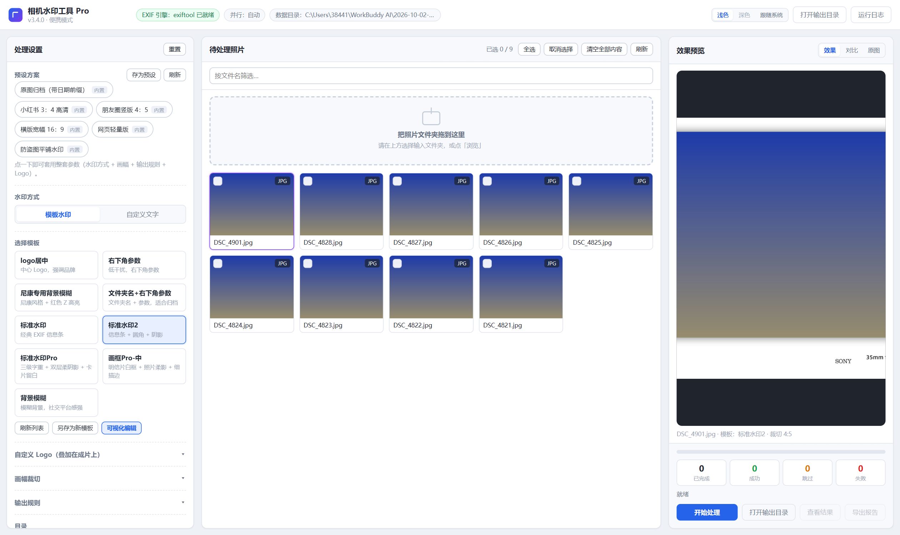
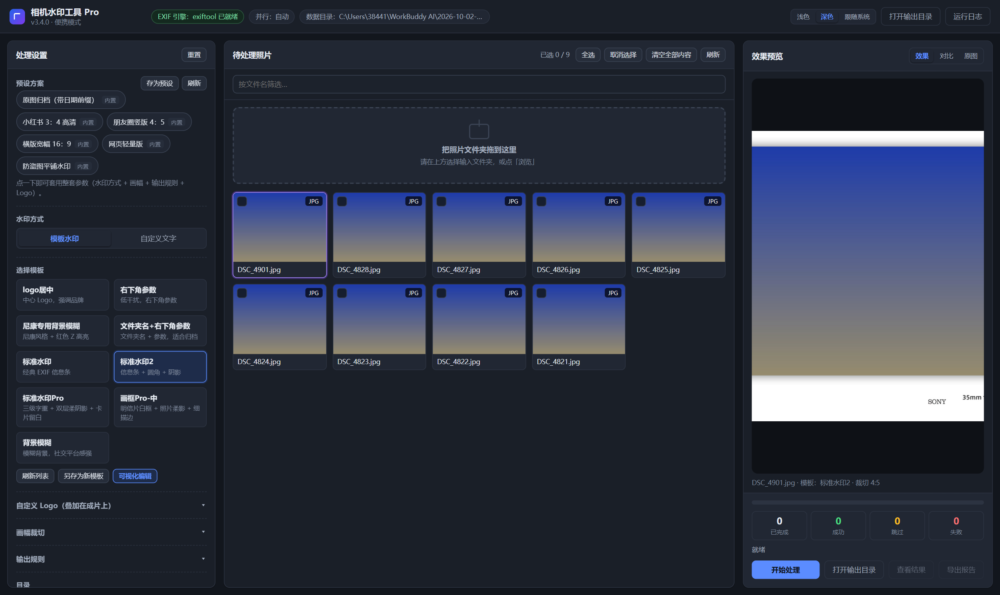
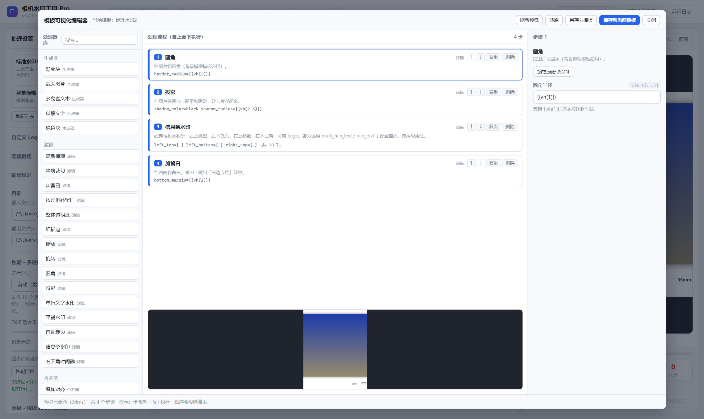
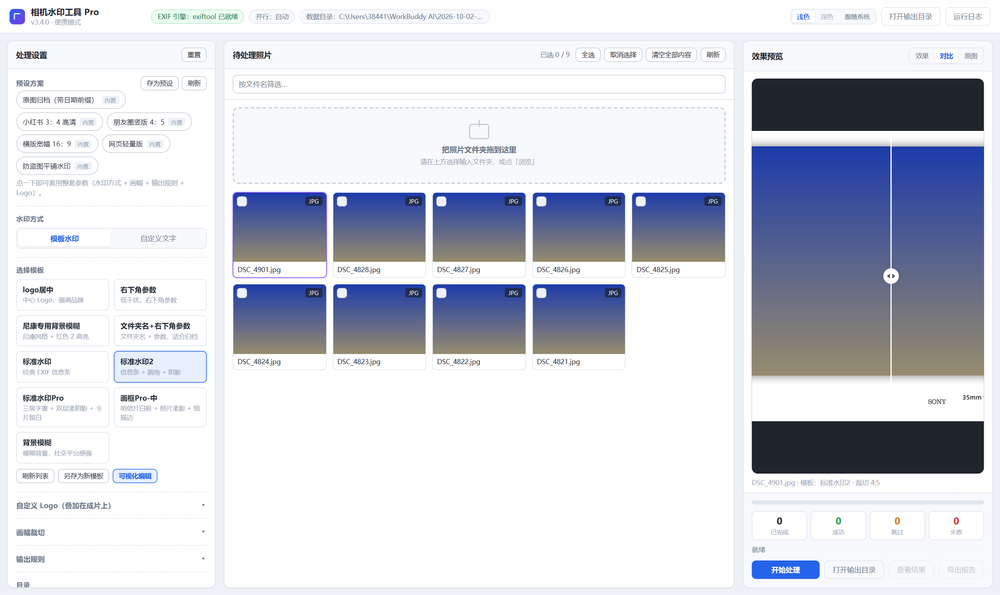
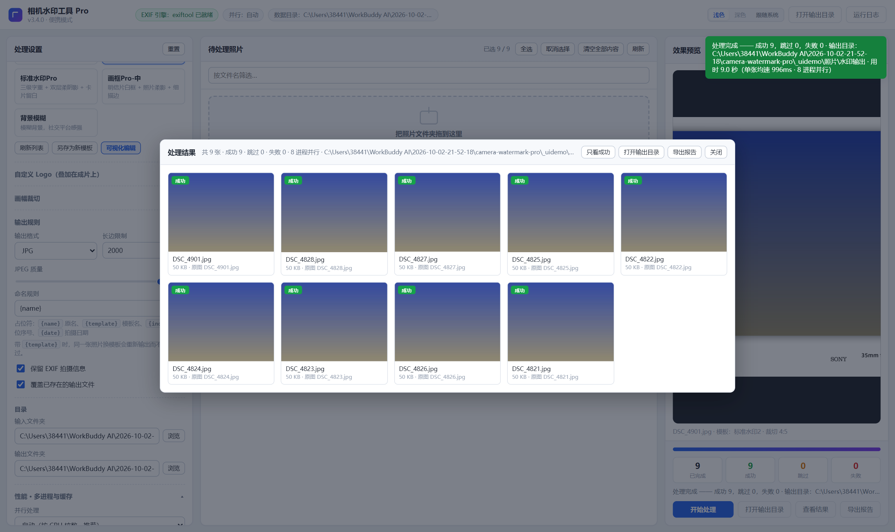

<div align="center">



# Camera Watermark Pro

**Batch-stamp professional EXIF info bars and brand logos onto your photos · 100% local · portable · fully offline**

[](https://github.com/beforeyouwereyoung-a11y/camera-watermark-pro/releases)
[](https://github.com/beforeyouwereyoung-a11y/camera-watermark-pro)
[](https://www.python.org/)
[](LICENSE)
[](CONTRIBUTING.md)

[简体中文](README.md) · [English](README.en.md) · [Docs](docs/) · [Issues](https://github.com/beforeyouwereyoung-a11y/camera-watermark-pro/issues)

</div>

---

## 📖 What is it

**Camera Watermark Pro** is a **fully local** batch photo-watermarking tool for Windows. It reads the EXIF shooting data from your photos and renders each frame with a tidy **camera / lens / shutter / aperture / ISO / date** info bar plus the **brand logo** — and also supports custom text watermarks, rounded corners & shadows, blurred backgrounds, and social-media crops.

No cloud uploads, no network, no installation — download and run. The source is structured to be easy to read and improve, and contributions of any kind are welcome.

> In one line: put *"the small caption a photographer wants in the corner of a shot"* onto a whole batch of photos — once, cleanly, and beautifully.

## ✨ Highlights

| | Feature | Details |
|---|---|---|
| 🖥️ | **Native desktop window** | Embedded WebView2 window — no browser needed; closing it minimizes to the system tray |
| ⚡ | **Multi-process batching** | Auto-parallel across CPU cores, ~**3×** faster than single-threaded; cancellable with progress / ETA |
| 🎞️ | **Full EXIF preservation** | Output keeps shooting metadata; brand & model auto-detected, logo matched per brand |
| 🎨 | **9 built-in templates** | Classic info bar, gallery-caption, frame, blurred background, minimal params… no code needed (visual editor) |
| 🧩 | **6 scenario presets** | Instagram/RedNote/16:9, archive-with-date, anti-theft tiling, web-light — one click to switch |
| 👁️ | **Live preview + compare** | Instant render on param changes; side-by-side compare with a draggable divider, double-click to zoom |
| 🔒 | **Never overwrites originals** | Choosing the same input/output dir triggers a warning and a one-click "use a subfolder" fix |
| 🌗 | **Light / Dark / Follow system** | Three themes, remembered across launches |
| 🧳 | **Portable** | Config, templates, logos and fonts travel with the program — copy the folder to a USB stick and go |

## 📸 Screenshots

<div align="center">
<table>
  <tr>
    <td></td>
    <td></td>
  </tr>
  <tr>
    <td align="center">Dark theme</td>
    <td align="center">Visual template editor: drag steps, tweak params, live preview</td>
  </tr>
  <tr>
    <td></td>
    <td></td>
  </tr>
  <tr>
    <td align="center">Compare mode with draggable divider</td>
    <td align="center">Results panel: thumbnails / compare / reveal / save-as</td>
  </tr>
</table>
</div>

> See [`screenshots/`](screenshots/) for all 15 UI screenshots.

## 🚀 Quick start

### Option 1 — Download the app (end users)

1. Grab the latest `CameraWatermarkPro.exe` from the [**Releases**](https://github.com/beforeyouwereyoung-a11y/camera-watermark-pro/releases) page;
2. Put it in any folder (e.g. `D:\CameraWatermark\`) and **double-click** — no installation;
3. On first launch it creates `config\`, `input\`, `output\`, `logs\` automatically.

> Windows 10/11 usually ships the **WebView2 Runtime**. If the window is blank,
> install [WebView2 Runtime](https://developer.microsoft.com/microsoft-edge/webview2/).

### Option 2 — Run from source (developers)

```powershell
git clone https://github.com/beforeyouwereyoung-a11y/camera-watermark-pro.git
cd camera-watermark-pro

python -m venv .venv
.\.venv\Scripts\Activate.ps1
pip install -r requirements.txt

# Native desktop window (recommended)
python desktop_app.py

# Or: browser mode at http://127.0.0.1:15050
python app.py
```

> Requires **Python 3.13+**. On Windows, `pywebview` pulls in `pythonnet` automatically.

### Optional — install ExifTool (full EXIF read/write)

The app prefers [ExifTool](https://exiftool.org/) for EXIF I/O and **falls back to Pillow** when it is missing — nothing breaks, just slightly lower accuracy on rare cameras/fields.

```powershell
# Download & unpack into ./exiftool/ (requires internet)
pwsh scripts/setup_exiftool.ps1
```

Or manually place `exiftool.exe` and `exiftool_files\` into an `exiftool\` folder at the project root. See [docs/BUILDING.md](docs/BUILDING.md).

## 🖼 Built-in templates

| Template | Style |
|---|---|
| **Standard** | Classic EXIF bar (model / lens / params / date + brand logo) |
| **Standard 2** | Same + rounded corner, shadow & padding for social media |
| **Standard Pro** | **Gallery-caption** style: white matte + bold brand / regular model + param row + logo bottom-right |
| **Frame Pro** | Postcard style: white border + soft shadow + 1px hairline |
| **Blur background** | Blurred background with centered model & params |
| **Nikon blur** | Nikon style with highlighted "Z" + blurred background |
| **Corner params** | Minimal — shooting params bottom-right only |
| **Folder name + params** | Folder name + date, great for archiving |
| **Centered logo** | Brand logo centered |

Templates live in `config/templates/*.json`; edit them via the built-in **visual editor** or as hand-written JSON.

## 🎛 Built-in presets

`Portrait 4:5` · `RedNote 3:4 HD` · `Wide 16:9` · `Archive (date prefix)` · `Anti-theft tiling` · `Web light`

## 🗂 Project layout

```
camera-watermark-pro/
├─ app.py                 # Flask app & REST API (preview / process / templates / presets / meta)
├─ desktop_app.py         # Desktop entry: WebView2 window + tray + single-instance guard
├─ core/                  # Infra: paths/config, EXIF reader, imaging, jobs, perf, logging
├─ processor/             # Watermark pipeline: schema → filters → generators → mergers
├─ static/                # Front-end assets (app.js / app.css)
├─ templates/index.html   # Single-page UI
├─ config/                # Bundled resources: fonts / logos / templates (seeded on first run)
├─ assets/logo.ico        # App icon
├─ docs/                  # User manual, build & architecture docs
├─ screenshots/           # UI screenshots
├─ selftest.py / smoke_test.py / test_*.py / ui_verify.py   # Self-checks & tests
├─ requirements.txt
├─ pyproject.toml
└─ LICENSE
```

## 🛠 Building from source

Use PyInstaller to produce a portable exe (both onedir and onefile forms). Full steps, dependency list and pitfalls: [docs/BUILDING.md](docs/BUILDING.md).

## 🤝 Contributing

All contributions are welcome — bug reports, feature requests, docs, code, new templates, translations.

- Please read [CONTRIBUTING.md](CONTRIBUTING.md) (branch, commit, and test conventions);
- Our [CODE_OF_CONDUCT.md](CODE_OF_CONDUCT.md) applies to every interaction;
- For security issues, follow [SECURITY.md](SECURITY.md) and report privately — not in a public issue;
- Beginner-friendly tasks carry the [`good first issue`](https://github.com/beforeyouwereyoung-a11y/camera-watermark-pro/labels/good%20first%20issue) label.

## 📄 License

Licensed under the [Apache License 2.0](LICENSE). Third-party components, fonts and trademark notices are documented in [NOTICE](NOTICE).

## ⚠️ Trademark disclaimer

Brand identifiers in `config/logos/` remain the property of their respective owners and are bundled solely for the fair use of "photo watermarking". This project is **not affiliated with, sponsored by, or endorsed by** any camera/phone manufacturer. See [NOTICE](NOTICE).

## 🙏 Acknowledgements

- [ExifTool](https://exiftool.org/) — the powerful EXIF engine
- [Pillow](https://python-pillow.org/), [Flask](https://flask.palletsprojects.com/), [pywebview](https://pywebview.flowrl.com/), [loguru](https://github.com/Delgan/loguru) and other great open-source projects
- Everyone who filed issues and sent PRs

<div align="center">

If this tool helps you, a ⭐ Star would be appreciated!

</div>
