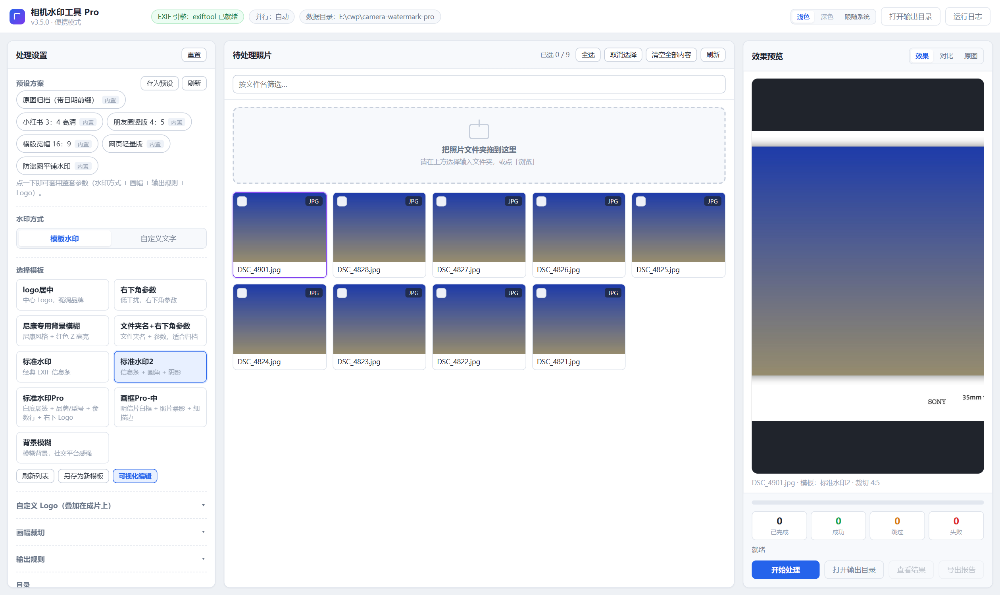
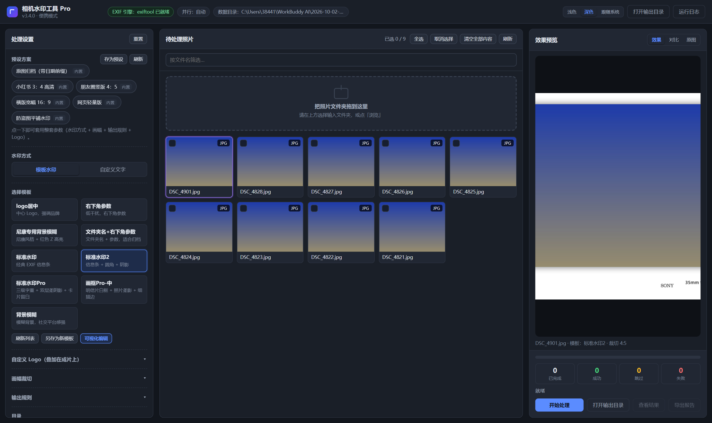
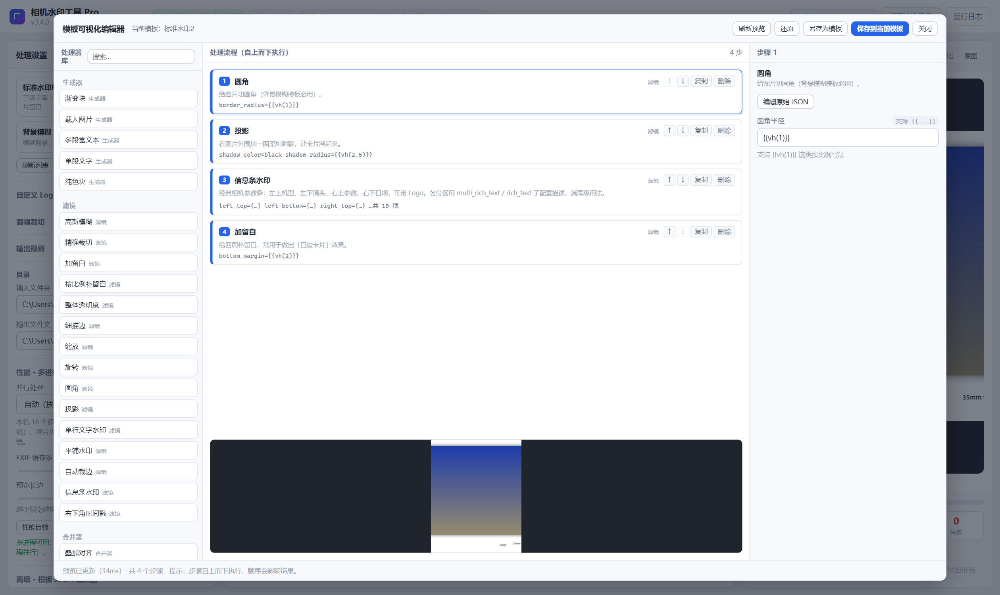
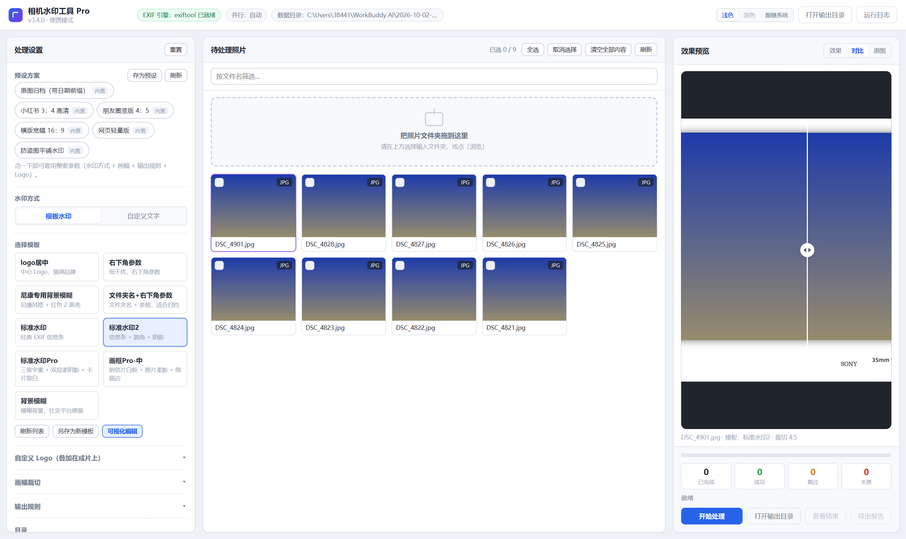
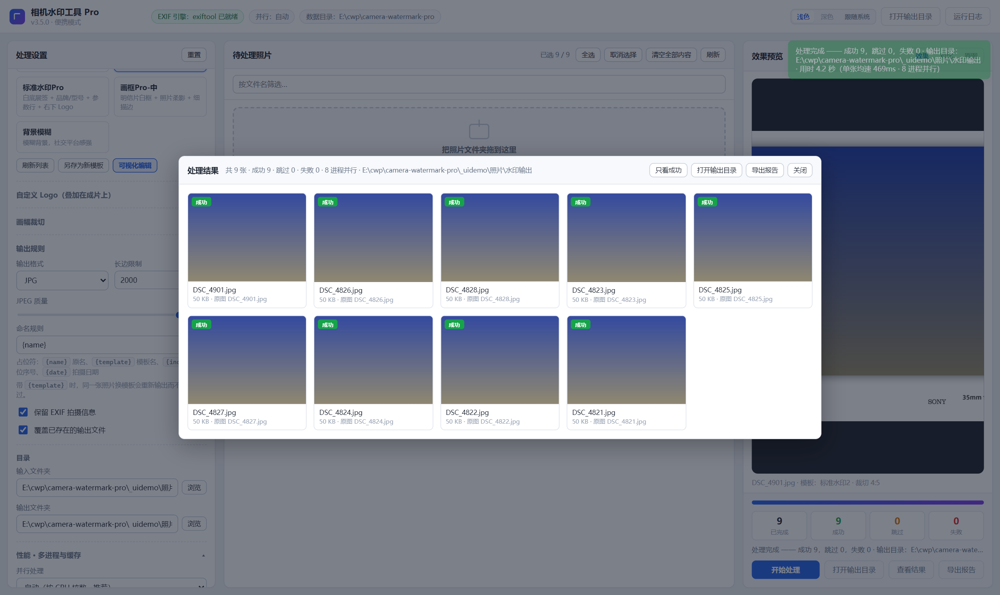

<div align="center">



# 相机水印工具 Pro

**给照片批量加上专业级的 EXIF 信息条与品牌 Logo · 纯本地 · 免安装 · 完全离线**

[](https://github.com/beforeyouwereyoung-a11y/camera-watermark-pro/releases)
[](https://github.com/beforeyouwereyoung-a11y/camera-watermark-pro)
[](https://www.python.org/)
[](LICENSE)
[](CONTRIBUTING.md)

[简体中文](README.md) · [English](README.en.md) · [在线文档](docs/) · [问题反馈](https://github.com/beforeyouwereyoung-a11y/camera-watermark-pro/issues)

</div>

---

## 📖 这是什么

**相机水印工具 Pro** 是一个在 Windows 上**纯本地运行**的照片批量水印工具。它可以读取照片的 EXIF 拍摄参数，批量生成带有 **机身/镜头/快门/光圈/ISO/日期** 信息条与**厂商 Logo** 的成片，也支持自定义文字水印、圆角阴影、模糊背景与社交平台裁幅。

它不做云端上传、不依赖网络、不需要安装——下载即用；源码结构清晰，欢迎任何人参与改进。

> 一句话：把「摄影师想在作品角落留下的那行小字」，一次性、批量、漂亮地加到一整组照片上。

## ✨ 核心特性

| | 特性 | 说明 |
|---|---|---|
| 🖥️ | **原生桌面窗口** | 基于 WebView2 的内嵌窗口，启动即用，无需浏览器；关闭窗口收进系统托盘 |
| ⚡ | **多进程批处理** | 自动按 CPU 核心并行，实测比单线程快约 **3 倍**；可随时取消并显示进度 / 剩余时间 |
| 🎞️ | **完整保留 EXIF** | 成片完整保留拍摄参数；自动识别机身品牌与型号，Logo 按品牌自动匹配 |
| 🎨 | **9 套内置模板** | 经典信息条、展签版式、画框、背景模糊、极简参数……改模板无需写代码（可视化编辑器） |
| 🧩 | **6 套场景预设** | 朋友圈 4:5、小红书 3:4、横版 16:9、原图归档、防盗图平铺、网页轻量版，一键切换 |
| 👁️ | **实时预览 + 对比** | 参数改完立刻出效果；左右分屏对比，分割线可拖动，双击铺满窗口看细节 |
| 🔒 | **绝不覆盖原图** | 输入/输出选成同一目录会立即提示，并给出一键「改为子目录」的修复 |
| 🌗 | **浅色 / 深色 / 跟随系统** | 三档主题，选择会被记住 |
| 🧳 | **免安装便携** | 配置、模板、Logo、字体全部跟着程序走，整个文件夹拷到 U 盘即可换机使用 |

## 📸 界面预览

<div align="center">
<table>
  <tr>
    <td></td>
    <td></td>
  </tr>
  <tr>
    <td align="center">深色主题</td>
    <td align="center">可视化模板编辑器：拖步骤 + 调参 + 实时预览</td>
  </tr>
  <tr>
    <td></td>
    <td></td>
  </tr>
  <tr>
    <td align="center">对比模式：分割线可拖动</td>
    <td align="center">结果面板：缩略图 / 对比 / 定位 / 另存</td>
  </tr>
</table>
</div>

> 更多界面截图（共 15 张）见 [`screenshots/`](screenshots/) 目录。

## 🚀 快速开始

### 方式一：下载现成程序（普通用户，推荐）

1. 到 [**Releases**](https://github.com/beforeyouwereyoung-a11y/camera-watermark-pro/releases) 页面下载最新的 `CameraWatermarkPro.exe`；
2. 放到任意目录（例如 `D:\相机水印\`），**双击运行**，无需安装；
3. 首次启动会自动创建 `config\`、`input\`、`output\`、`logs\` 等目录。

> Windows 10/11 一般已自带 **WebView2 运行时**；若窗口一片空白，到微软官网安装
> [WebView2 Runtime](https://developer.microsoft.com/microsoft-edge/webview2/) 即可。

### 方式二：从源码运行（开发者）

```powershell
git clone https://github.com/beforeyouwereyoung-a11y/camera-watermark-pro.git
cd camera-watermark-pro

python -m venv .venv
.\.venv\Scripts\Activate.ps1
pip install -r requirements.txt

# 原生桌面窗口（推荐）
python desktop_app.py

# 或：浏览器模式，访问 http://127.0.0.1:15050
python app.py
```

> 要求 **Python 3.13+**。`pywebview` 在 Windows 上会自动带上 `pythonnet` 依赖。

### 可选：安装 ExifTool（获得完整 EXIF 读写能力）

程序优先调用 [ExifTool](https://exiftool.org/) 读写 EXIF；**未安装时会自动降级**用 Pillow 读取常见字段，功能不受阻，只是冷门机型/字段识别率略低。

```powershell
# 一键下载解压到 ./exiftool/ （需要联网）
pwsh scripts/setup_exiftool.ps1
```

或手动把 `exiftool.exe` 与 `exiftool_files\` 放进项目根目录的 `exiftool\` 文件夹。详见 [docs/BUILDING.md](docs/BUILDING.md)。

## 🖼 内置模板

| 模板 | 风格 |
|---|---|
| **标准水印** | 经典 EXIF 信息条（机型 / 镜头 / 参数 / 日期 + 品牌 Logo） |
| **标准水印2** | 同上 + 圆角阴影留白，适合社交平台 |
| **标准水印Pro** | **摄影作品展签**风格：纯白卡纸留白 + 品牌粗体 / 型号常规 + 参数行 + 右下角 Logo |
| **画框Pro-中** | 明信片风格：四周留白框 + 柔影 + 1px 极淡描边 |
| **背景模糊** | 模糊背景 + 居中机型与参数 |
| **尼康专用背景模糊** | 尼康风格，Z 字高亮 + 模糊背景 |
| **右下角参数** | 极简，仅在右下角显示拍摄参数 |
| **文件夹名+右下角参数** | 文件夹名 + 拍摄日期，适合归档 |
| **logo居中** | 居中展示品牌 Logo |

模板均为 `config/templates/*.json`，可用内置的**可视化编辑器**调整，也可手写 JSON。

## 🎛 内置预设

`朋友圈竖版 4:5` · `小红书 3:4 高清` · `横版宽幅 16:9` · `原图归档（带日期前缀）` · `防盗图平铺水印` · `网页轻量版`

## 🗂 项目结构

```
camera-watermark-pro/
├─ app.py                 # Flask 应用与 REST API（预览 / 处理 / 模板 / 预设 / 元信息）
├─ desktop_app.py         # 桌面入口：WebView2 原生窗口 + 系统托盘 + 单实例保护
├─ core/                  # 基础设施：路径/配置、EXIF 读取、图像处理、任务队列、性能、日志
├─ processor/             # 水印渲染管线：schema（参数）→ filters（滤镜）→ generators → mergers
├─ static/                # 前端资源（app.js / app.css）
├─ templates/index.html   # 单页界面
├─ config/                # 内置资源：fonts / logos / templates（首次运行播种到数据目录）
├─ assets/logo.ico        # 应用图标
├─ docs/                  # 使用手册、构建说明、架构说明
├─ screenshots/           # 界面截图
├─ selftest.py / smoke_test.py / test_*.py / ui_verify.py   # 自检与测试
├─ requirements.txt
├─ pyproject.toml
└─ LICENSE
```

## 🛠 从源码打包

使用 PyInstaller 可打出一体化便携 exe（onedir / onefile 两种形态）。完整步骤、依赖清单与常见坑见 [docs/BUILDING.md](docs/BUILDING.md)。

## 🤝 参与贡献

欢迎任何形式的贡献：报 Bug、提需求、改文档、写代码、加模板、翻译。

- 提交前请阅读 [CONTRIBUTING.md](CONTRIBUTING.md)（分支规范、提交信息、测试要求）；
- 行为准则见 [CODE_OF_CONDUCT.md](CODE_OF_CONDUCT.md)；
- 发现安全问题请按 [SECURITY.md](SECURITY.md) 私下报告，勿公开 Issue；
- 维护者发布流程（推送 / 截图 / Release / CI）见 [docs/MAINTAINER.md](docs/MAINTAINER.md)；
- 好上手的任务会打上 [`good first issue`](https://github.com/beforeyouwereyoung-a11y/camera-watermark-pro/labels/good%20first%20issue) 标签。

## 📄 许可证

本项目基于 [Apache License 2.0](LICENSE) 开源。第三方组件与字体、商标声明详见 [NOTICE](NOTICE)。

## ⚠️ 商标与免责声明

`config/logos/` 中的品牌标识版权与商标权归各自权利人所有，仅用于「摄影作品水印」这一合理用途，**不代表本项目和任何厂商存在隶属、赞助或背书关系**。详见 [NOTICE](NOTICE)。

## 🙏 致谢

- [ExifTool](https://exiftool.org/) — 强大的 EXIF 读写引擎
- [Pillow](https://python-pillow.org/)、[Flask](https://flask.palletsprojects.com/)、[pywebview](https://pywebview.flowrl.com/)、[loguru](https://github.com/Delgan/loguru) 等优秀开源项目
- 所有提交 Issue 与 PR 的贡献者

<div align="center">

如果这个工具帮到了你，欢迎点一个 ⭐ Star！

</div>
